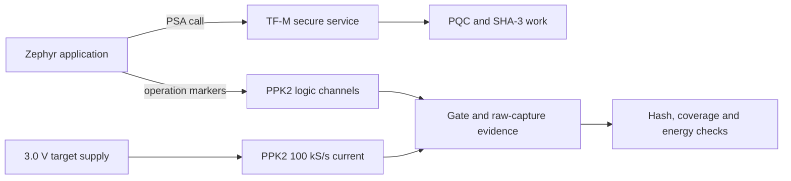

# Zephyr / TF-M PQC measurement showcase

A small, runnable public example of how I separate a post-quantum operation from its measurement evidence on a TrustZone-enabled microcontroller. The larger research system places PQC and key handling at different Zephyr/TF-M boundaries, then validates correctness, timing, memory and supply-domain energy. This repository shows the **evidence contract** and a host-side gate integrator, not the full firmware or an accelerator driver.



## Try the example

Only Python's standard library is required:

```bash
python3 evidence.py examples/synthetic_capture.json examples/synthetic_samples.csv
python3 -m unittest discover -s tests -v
```

The fixture is **synthetic**. Its output demonstrates how to bind a trace to a SHA-256 digest, require exactly the declared operation gates, and integrate current over each gate. Its energy values are not nRF5340 results. The full research traces, firmware, identity material and unpublished measurements are not included.

## What the checker requires

- A 100,000 samples/s source-meter capture with its exact SHA-256 digest and sample count.
- A declared voltage and measurement boundary. Energy is the **gross** supplied energy for that boundary; debug and UART loads are included if connected.
- Monotonic sample indices, finite nonnegative current, and contiguous, uniquely identified gates with the expected operation counts.
- A result that can be independently regenerated from the retained CSV. Missing gates, changed data, or malformed samples fail closed.

The sample is intentionally narrow: a logic marker identifies an operation, but cannot measure current on its own. This host checker does not authenticate the device, calibrate the meter, prove constant-time behavior, or certify a cryptographic implementation. Those require separate hardware and security evidence.

## Related public work

- [Zephyr/QEMU PQC benchmark framework](https://github.com/atsanak/zephyr-pqc-benchmarking): larger cross-ISA methodology with **modelled** energy.
- [Zephyr embedded PQC engineering portfolio](https://github.com/atsanak/zephyr-embedded-pqc-benchmarking): public code and ACVP/KAT paths; maintained separately.

The distinction between QEMU modelled energy and physically measured supply-domain energy is deliberate. No number from one is substituted for the other.

## License

MIT; see [LICENSE](LICENSE).
